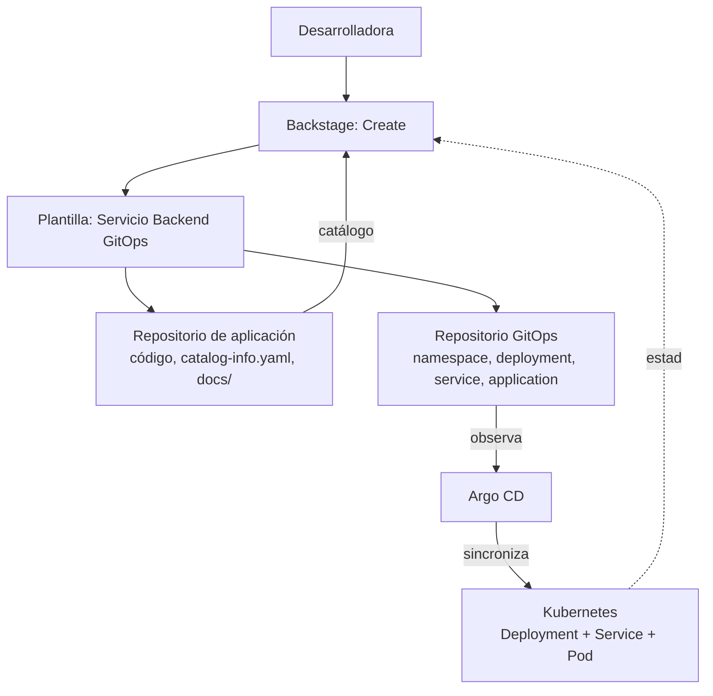

# Golden Path: Crear y desplegar un microservicio con GitOps

## Consumidor

Desarrolladora backend junior (ver `fuentes/consumidor.md`).

## Problema

Crear y desplegar un servicio requiere configurar repositorios, manifiestos
Kubernetes, pipelines y solicitudes manuales de despliegue.

## Objetivo

Permitir crear un servicio estándar, registrado en Backstage y desplegado
en Kubernetes mediante GitOps y Argo CD.

## Camino recomendado

1. Ingresar a Backstage.
2. Seleccionar **Create**.
3. Elegir la plantilla **"Servicio Backend GitOps"**.
4. Completar nombre, descripción, owner, sistema y repositorio.
5. La plantilla genera el repositorio de aplicación con:
   - código base
   - `catalog-info.yaml`
   - `docs/index.md`
   - manifiestos Kubernetes
6. La plantilla crea o actualiza el repositorio GitOps.
7. Argo CD detecta la nueva aplicación en Git.
8. Argo CD sincroniza los manifiestos hacia Kubernetes.
9. La desarrolladora verifica el estado en Backstage y Argo CD.
10. Si necesita ayuda, consulta RAG o contacta al equipo propietario.

## Criterios de éxito

- El componente aparece en el catálogo de Backstage.
- El repositorio GitOps contiene los manifiestos del servicio.
- Argo CD muestra la aplicación como **Synced** y **Healthy**.
- El pod del servicio está en estado **Running**.
- No fue necesario ejecutar `kubectl apply` manualmente.

## Repositorios usados en este laboratorio

| Elemento | Ubicación |
|---|---|
| Repositorio Git | https://github.com/bermudezkenny03/laboratorio-plataforma-gitops |
| Repositorio de aplicación | carpeta `repo-aplicacion/` |
| Repositorio GitOps (lo que vigila Argo CD) | carpeta `repo-gitops/`, ruta `repo-gitops/apps/gestion-acueductos-api` |
| Plantilla del Golden Path | carpeta `plantilla-servicio-backend/` |

> En una organización real `repo-aplicacion` y `repo-gitops` serían dos repositorios
> separados. En este laboratorio viven como carpetas de un mismo repositorio para
> entregarlo todo junto; Argo CD solo observa la ruta `repo-gitops/apps/gestion-acueductos-api`.

## Diagrama del flujo GitOps

```text
Desarrolladora
      |
      v
Backstage: Create
      |
      v
Plantilla: Servicio Backend GitOps
      |
      +--> Repositorio de aplicación
      |      ├── código
      |      ├── catalog-info.yaml
      |      └── docs/
      |
      +--> Repositorio GitOps
             └── apps/gestion-acueductos-api/
                    ├── namespace.yaml
                    ├── deployment.yaml
                    ├── service.yaml
                    └── argocd-application.yaml
      |
      v
Argo CD detecta cambios en Git
      |
      v
Argo CD sincroniza el estado deseado
      |
      v
Kubernetes: Deployment + Service + Pod
      |
      v
Backstage muestra el componente y su estado
```


